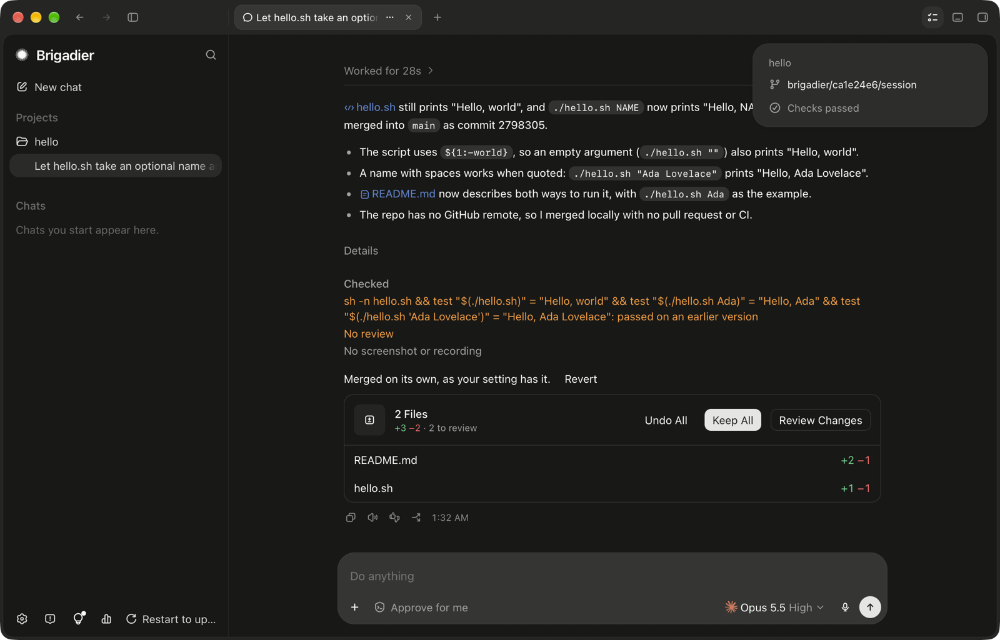

# Brigadier

[](https://github.com/syncra-studio/brigadier-ai/actions/workflows/ci.yml)
[](LICENSE)
[](#status-and-roadmap)

**Brigadier runs Claude Code and Codex as one team on your Mac.** You talk to one thread. It
makes small changes itself, hands the rest to agents running in parallel in their own git
worktrees, and the other vendor's model reviews every change in the background.



- **Parallel agents, cross-vendor review.** Each task runs in its own worktree on the model
  best suited to it, and its commits land by fast-forward. Every worker's change also gets a
  read-only review from the other vendor (Codex reviews Claude's work, Claude reviews Codex's) in
  the background, and the work doesn't wait for it. The thread fixes the findings or says why not.
- **Computer use in the background (macOS).** Workers can open and use the apps they build, and
  any other app a task needs, without moving your cursor or bringing the app to the front: a
  step that would interrupt you is refused. System Settings is read-only to them. The
  helper builds on a vendored open-source driver:
  [helpers/computer-use/README.md](helpers/computer-use/README.md).
- **Long sessions without compaction.** The thread never compacts its context. Before it fills, a
  fresh session takes over from a handoff note, every decision so far and the latest messages.
  Workers start with what the thread already read, search a local code index before reading
  files, and ask the Project Brain what earlier sessions learned.

Free and open source (MIT). Brigadier runs the `claude` and `codex` CLIs you already have, under
your own logins. It holds no API keys and never reads your credentials.

## Install

macOS 14 or later, Apple silicon or Intel. Signed and notarized.

```sh
brew install --cask syncra-studio/tap/brigadier
```

Or download `Brigadier-0.1.0-alpha-universal.dmg` from the
[latest release](https://github.com/syncra-studio/brigadier-ai/releases/latest) and drag
Brigadier to Applications. It updates itself. More ways, and how to uninstall:
[docs/user/install.md](docs/user/install.md).

You also need at least one of [Claude Code](https://docs.anthropic.com/en/docs/claude-code) and
[Codex](https://github.com/openai/codex); Brigadier's setup can install them. Both is
better: each reviews the other's work. To build from source (or for Windows and Linux), see
[docs/DEVELOPMENT.md](docs/DEVELOPMENT.md). Windows builds a per-user installer
(`…-x64-setup.exe`) there; Windows releases aren't published yet
([docs/user/install.md](docs/user/install.md#windows)).

## Quick start

1. Open Brigadier. Its setup connects your agents: it finds `claude` and `codex`, and can
   install them or sign them in for you.
2. Pick a project: one it suggests from your recent Claude Code and Codex work, or any git
   repository (**+** next to **Projects**). It can also clone one, or start git in a folder.
3. Press **New session** on the project and say what you want in plain words.
4. The session works on its own branch, in its own worktree: it plans and changes the code, while
   your checks and the other vendor's review run in the background. Then it merges the work, and a
   **Revert** button sits under the merge message.

Step by step: [docs/user/first-task.md](docs/user/first-task.md).

## Sessions

One session is one task: a chat with an agent, on its own branch and worktree. The sidebar lists
each project's sessions with what each is doing and why (Working · watching CI, Needs you ·
question, Ready · PR open, Merged); the ones that need you come first. For a second task at the
same time, start another session: **New session** on the project, or **⌘Enter** in the composer
to start it in the background. A session can also offer to start something outside its task as
its own session. The tab bar holds the open session's chat and its own terminals, browser pages
and files. More: [docs/user/sessions-and-tabs.md](docs/user/sessions-and-tabs.md).

## Auto-merge and Revert

Finished work merges on its own: through a pull request when the project is on GitHub and `gh` is
signed in, otherwise into the base branch on your Mac. Checks and review inform the merge without
holding it; the merge message says what was verified. Each merge message has a **Revert** button.
Turn it off in Settings › Git. More: [docs/user/auto-merge-and-revert.md](docs/user/auto-merge-and-revert.md).

## Accounts

Brigadier uses the logins your CLIs already have; there is no Brigadier account. Add more Claude
Code or Codex accounts in Settings › Providers; when one runs out, work moves to another.
More: [docs/user/accounts.md](docs/user/accounts.md).

## Privacy

- Runs your own `claude` and `codex`, unmodified, under your own logins.
- Never reads your login tokens or API keys, and holds none.
- No account, no server, no telemetry. Your sessions and settings stay in
  `~/Library/Application Support/Brigadier`.

What it does fetch (updates, the model list, two small local models):
[docs/user/privacy.md](docs/user/privacy.md).

## Status and roadmap

Brigadier is alpha software, built in the open by one developer since September 2026. Expect
rough edges.

- **macOS** is the main platform, and every feature here works on it.
- **Windows and Linux** build and pass a launch check in CI (Linux on every push, Windows
  nightly), but are not ready for real use. The worker sandbox, computer use and browser data
  import are macOS-only for now. Agents in the browser work on macOS and Windows; Linux has no
  built-in browser.
- **Agents:** Claude Code and Codex today. Next: the Cursor, opencode and Grok CLIs, and local
  models.

## What's in it

- **Sessions.** One thread per task, on its own branch and worktree. It reads and runs things,
  makes small changes itself, starts workers for the rest, and merges the result (with a Revert
  button).
- **Overnight runs.** Type `/overnight` with a plan and when it should be ready. The session works
  through the plan phase by phase until it's done or the deadline comes, then leaves a morning
  report and a notification.
- **Sessions that message each other.** A session's thread can send a message to another
  session, in the same project or another one, and the reply comes back to it on its own. Both
  sides show the exchange. Under Ask for approval, each message waits for your Send.
- **Long commands in the background.** A command the thread runs that is still going after a
  minute moves to the background with a live line, and its result comes back to the thread when
  it ends. A turn's steps fold under "Worked for …" once the answer starts. A sidebar dot marks a
  conversation whose request finished since you last opened it.
- **Chats and side chats.** A Chat is a plain conversation with one model and web search. A side
  chat asks a question about a session without adding it to the session's thread.
- **Several accounts per agent.** Sign in to more than one Claude Code or Codex account and pick
  which one new conversations use (Settings › Providers). When one runs out, Brigadier switches
  to another (a setting, on by default).
- **Usage and fallback.** The sidebar's usage button and Settings › Providers show each
  agent's usage windows and where they are heading. A worker whose provider hits its limit hands its task to the best other model, in the
  same worktree. A conversation continues on the other vendor and goes back after the reset.
- **Built-in browser** (macOS, Windows). Opens the pages agents and you work on, with history and
  downloads. On macOS it also has per-site camera and microphone choices, and can import cookies
  and history from your other browsers. On macOS agents use it too: they read and work a page in a
  background tab with your sign-ins, you take over by using the page (**Continue** hands it back),
  and paying, signing in or sending in your name asks you first.
- **Terminals, files, review and source.** Terminal tabs, a file tree, a review of everything a
  session changed, and git actions beside the thread.
- **Dictation and read aloud.** Dictation runs a speech model on your computer, so the audio never
  leaves it. Read aloud uses the system voice.
- **Clean up after itself.** Archiving a session removes its worktrees, scratch folders, CLI
  session files and processes. **Uninstall Brigadier…** (in the menu bar and Settings › Storage)
  removes what it made.

## How it uses your CLIs and accounts

Brigadier drives the `claude` and `codex` CLIs installed on your machine, found on your login
shell's `PATH`, with the logins you already have. It never reads their credentials and holds no
API keys of its own. Each extra account you add gets its own CLI home inside Brigadier's data
folder, so your terminal login never changes. Brigadier changes the CLIs' own config only to undo
a trust entry a session made Codex write. The files a session makes a CLI write (Claude's
transcript and task files, Codex's rollout) are removed when the session is closed or archived.

Each project can name gitignored env files (such as `.env.local`) as secrets: they are copied into
each worker's worktree, never committed, and their values are redacted from everything Brigadier
records.

## How it works

### Sessions

A session is one long-lived CLI session (Claude or Codex), the **thread**, that talks with you.
It reads code, runs builds and tests, and makes a small change itself: one bounded change in one
area, about 100 changed lines or fewer. Everything else goes to **workers**: one CLI session per
task, on a model the router picks for that kind of work. A write task gets its own worktree on a
task branch and a scratch folder outside the repository. It starts with a context pack (what
the thread already read and searched) and with the dependency installs and build caches of your
checkout copied in, so its first build doesn't start from nothing. Workers follow your repository's `CLAUDE.md` and `AGENTS.md` whichever
vendor runs them.

A worker reports when it's done. Its commits then **land**:

- **Rebased** onto the target's tip if it moved. A conflict goes to a merge worker.
- **Fast-forwarded** onto your checked-out branch (local checkout) or the session branch
  `brigadier/<session>/session` (new worktree). Landing into your checkout never overwrites
  uncommitted, untracked or ignored files. If it would, or if the branch moved unexpectedly, the
  task waits as "ready to land" and nothing changes.
- **Checked** once on the combined work. Workers run only the checks of their own change; the
  project's full checks run in the background on the branch the work landed on, and a failure
  goes back to the worker that caused it. The merge doesn't wait for them: its message says
  where they stood.
- **Reviewed** in the background. Every worker's change gets one read-only review by the other
  vendor, in its own checkout. A worker starts it once its work is committed and reports without
  waiting for it. The thread's own changes get one once they reach about 150 changed lines or
  more than five code files, or when it marks them risky, and it waits for those findings before
  it answers. Findings that reach a
  worker before it reports are its to fix. Later ones go to the thread as a message, and the
  thread fixes them or says why not. Settings › Configuration › "Review the work" turns reviews
  off (they're on by default).

When the session's work is ready, the thread merges it into its base: through a pull request when
the project is on GitHub and `gh` is signed in, otherwise on your Mac. The full checks and the
reviews inform the merge without holding it, and the merge message says where they stood. The
merge message has a Revert button that asks the thread to undo it the way it went in. With
Settings › Git › "Merge on its own when the work is ready" off, the thread tells you the work is
ready and merges when you ask.

Archiving a session removes its worktrees, scratch folders, CLI session files and processes,
including detached children. Unfinished work is kept as a WIP commit on its task
branch, or as a patch when it overlaps uncommitted changes you let workers see. Anything that
couldn't be removed is retried at the next launch.

### Permission levels

A session's permission level is picked in the composer. **Fresh installs start in Approve for me**;
Settings › Configuration changes the default for new sessions. Existing installs keep their saved
default, and existing sessions keep their chosen level.

- **Ask for approval**: you approve every plan and every change before it lands. Workers run
  in the OS sandbox without network. Each step outside it (another folder, a host to reach)
  asks you on a card. The "Allow … for this session" button allows commands with the same first
  words (such as `git push` or `curl`), connections to the same host, or file changes inside
  the asker's own checkout or worktree for the rest of the conversation. File changes outside
  that folder, in Git metadata, or in the CLIs' own config (`.claude`, `.codex`, `.agents`,
  `.vscode`, `.mcp.json`) still ask. These grants live in memory only. A message to another
  session waits on a card for your Send.
- **Approve for me**: Brigadier approves plans and changes for you (a risky plan gets an
  independent review first) and asks you only what only you can answer. Workers run in the OS
  sandbox with network. When a command needs more, Claude's auto mode or Brigadier's reviewer
  for Codex decides and declines what it judges unsafe.
- **Full access**: as Approve for me, but workers run like your own terminal (Claude in
  `bypassPermissions`, Codex with no sandbox and no approvals). They can read, change and delete
  any file your account can, run any command and use the internet, without asking. The composer
  shows a notice while a conversation is in Full access.

These sandbox descriptions apply to macOS. On Linux and Windows, the level still requests the
CLI's sandbox and approval review, but support depends on the installed CLI and OS. Brigadier's
own worker sandbox is macOS-only; Windows and Linux remain incomplete
(see [Status and roadmap](#status-and-roadmap)).

In the sandbox a worker can write to its own worktree and scratch folder, its worktree's git
folder (so it can commit) and the toolchains' caches (`~/.cargo`, `~/.rustup`, the npm, pnpm,
yarn and bun caches, `~/Library/Caches`, the temporary folder), so builds, tests and installs
just work. Claude's sandbox lets network traffic out only as HTTP(S) through its proxy, so a push
over `git://` or `ssh` from a sandboxed Claude worker fails.

At every level, workers and the thread push, publish, deploy or open pull requests when the
task calls for it, with your own git and `gh` sign-ins. The thread asks for your approval before
it spends money, uses credentials or the keychain, or destroys something outside the session's
own work; a worker lists such steps for you instead.

### What still depends on trust

- Workers and threads get grants scoped to their role and task, checked on every call to
  Brigadier's MCP server and revoked when the session ends. Requests only the UI may make (such as
  answering approvals) need the IPC token in `<data>/run/`. Claude workers can't read that
  folder, and neither can read-only Codex sessions. A Codex worker that writes in a worktree
  runs in Codex's older sandbox, which can't deny reads, so a hostile one could read the token.
  On macOS it still can't act as the UI: the daemon refuses the token from any sandboxed process.
  On Linux and Windows, which have no worker sandbox yet, nothing refuses it.
- A process that detaches and moves out of Brigadier's folders escapes the cleanup.
- A thread can message sessions in other projects. The receiver hears it as coming from another
  session, not from you. After eight messages with no word from you, the next one still goes
  and the sending thread is told how many went back and forth. One session can send another at
  most twenty messages a minute.
- Codex writes a trust entry into `~/.codex/config.toml` when a thread starts with a writable
  sandbox in a folder you never trusted. Brigadier starts every thread without a sandbox of its
  own and sets it per turn, so Codex writes none. If one ever appears for a folder Brigadier
  created, it is removed when the session closes, and only while it is still exactly `trusted`.

To report a security problem, see [SECURITY.md](SECURITY.md).

### Project Brain

Each project has a Brain: what Brigadier knows about it, so a question answered once is not
investigated again. It is a graph of modules, file summaries, decisions, conventions, reports and
research, each with where it came from (the code index, a worker's report, the thread, you), and
from which session, model and commit. The thread asks it first, using full-text search plus local
embeddings, then one hop along the graph. It also keeps what you settle. Reports, plan decisions
and your answers on cards are recorded without being asked.

- **Code index.** The repository is scanned (tree-sitter symbols and references, manifests,
  scripts) and kept current by a file watcher. Workers search it before reading files.
- **Staleness.** Nodes remember the content hash of the files they describe. When a file
  changes, they're marked stale and answered as "may be outdated".
- **Spare quota.** After a project's first scan, the cheapest model maps its modules, stack,
  conventions and build recipe. Quota that would expire unused refreshes stale nodes and fills
  gaps, and it stops as soon as your own work starts.
- **Personal memory.** Stable facts about you (where you live, your work, your tools, what you
  prefer) are given to new threads and Chats; you see, edit and delete them in Settings › Memory.
  Passwords, keys, card and account numbers are never kept.

Everything stays in the data folder: `brains/<project>/brain.sqlite`, `index.sqlite`,
`brains/personal.sqlite`, and the embedding model under `models/embeddings/`.

### Routing and quota

Brigadier picks each worker's model and says why on the worker's card.

- **Registry.** `registry/models.json` rates every model Brigadier drives: strengths per kind of
  work, efforts, context window. The app checks this repository for a newer revision daily. It
  takes one only if it stays within fixed bounds and has a higher revision.
- **Outcomes.** Every model's run of a task is recorded per project (result, review findings,
  rework, time, tokens), and nudges that model's score for that kind of work in that project.
- **Your choices.** Each agent's page in Settings › Providers turns its models on or off.
  Settings › Routing says who does what: a model per kind of work, or Automatic, plus rules
  with a live preview.
- **Quota.** Brigadier reads Claude's and Codex's usage windows, projects each one to its reset,
  and shifts new work away from a provider that's running hot.
- **Fewer tokens, built in.** Nothing to turn on. A thread idle past its prompt cache restarts
  from a checkpoint briefing instead of resending its whole history. A worker at about two-thirds of
  its model's context window (200k tokens at most) hands over to a fresh session of the same model.
  Workers start without the built-in tools they never use. Brain answers return a few results of each kind and page the rest.

### Settings

Settings is grouped into Personal (General, Voice, Configuration, Keyboard shortcuts), Agents
(Providers, Routing, Git, Computer use), Browser & Data (Browser, Import Browser Data) and System
(Storage, Inspector), with Archived chats at the end. Settings › Computer use (macOS) turns it
on or off and walks through its Accessibility and Screen Recording permissions. Accounts:
[docs/user/accounts.md](docs/user/accounts.md).

## Uninstall

Use **Uninstall Brigadier…**, from the menu bar (Brigadier ▸ Uninstall Brigadier…) or Settings ›
Storage. It stops every conversation as archiving does (unfinished work kept as WIP commits), then
removes everything Brigadier recorded making: worktrees, scratch folders, CLI session files and
processes. If the app is already deleted, run the script from this repository (its options are in
[docs/DEVELOPMENT.md](docs/DEVELOPMENT.md#the-uninstall-script)):

```sh
scripts/uninstall.sh --dry-run --app-id ai.brigadier.app
scripts/uninstall.sh --app-id ai.brigadier.app
```

On Windows, Uninstall Brigadier… is in Settings › Storage; then remove the app in Settings ›
Apps › Installed apps. The script there is `scripts\uninstall.ps1 -DryRun -AppId ai.brigadier.app`
(and without `-DryRun`), which also runs the app's own uninstaller.

Neither removes the computer-use helper's Accessibility and Screen Recording entries: remove
"Brigadier Computer Use" from System Settings › Privacy & Security yourself.

## Contributing, security, license

- [CONTRIBUTING.md](CONTRIBUTING.md): read it before you open an issue or a pull request. Pull
  requests need an accepted issue first, and they're closed automatically without one.
- [docs/DEVELOPMENT.md](docs/DEVELOPMENT.md): building, checks, layout and dependency notes.
- [SECURITY.md](SECURITY.md): report vulnerabilities privately, never in a public issue.
- [CODE_OF_CONDUCT.md](CODE_OF_CONDUCT.md): Contributor Covenant 2.1; report problems to
  hello@syncra.studio.
- [docs/](docs/README.md): design plans and dated evidence (measurements and acceptance runs).
- MIT, see [LICENSE](LICENSE). Third-party notices: [THIRD_PARTY_NOTICES.md](THIRD_PARTY_NOTICES.md).

Brigadier is made by SYNCRA SRL. Founded and developed by Stephen Golban.
