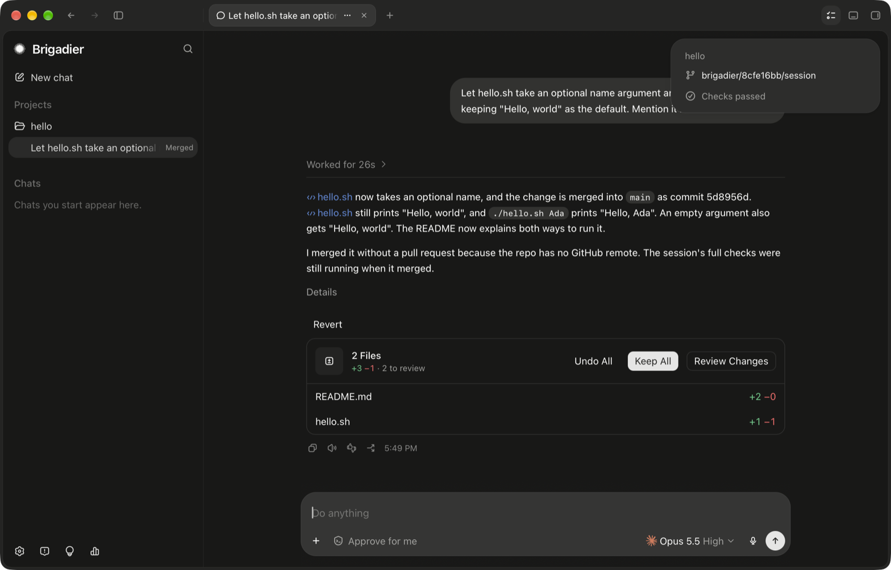

# Auto-merge and Revert

When a session's work is done, Brigadier merges it for you. That is on by default.

## What happens

1. When the agent judges the work ready, it merges it, without asking. If the project is on GitHub
   and `gh` is signed in, it pushes the branch, opens a pull request, watches its CI and reviews,
   fixes what they find, and merges it. Otherwise it merges the branch into its base on your Mac.
2. Your project's full checks and the other agent's review run in the background. They inform the
   merge but don't hold it: the merge message says what was verified and what was still running
   or left out.
3. A line in the chat says what happened: "Merged *branch* into *base*", or "… on this Mac, not
   pushed to *remote*" when nothing was pushed.

## Revert

Under the merge message there is a **Revert** button. It asks the agent to undo that merge the way
it went in: a revert commit on the base branch, pushed if the merge was pushed. The button then
reads **Revert asked**, and the agent reports when it's done.

You can also just ask in the chat, in your own words.

## Turning it off

**Settings › Git › Merge on its own when the work is ready.** Off, the agent tells you when the
work is ready and you merge: ask it in the chat, or merge the branch or pull request yourself.
